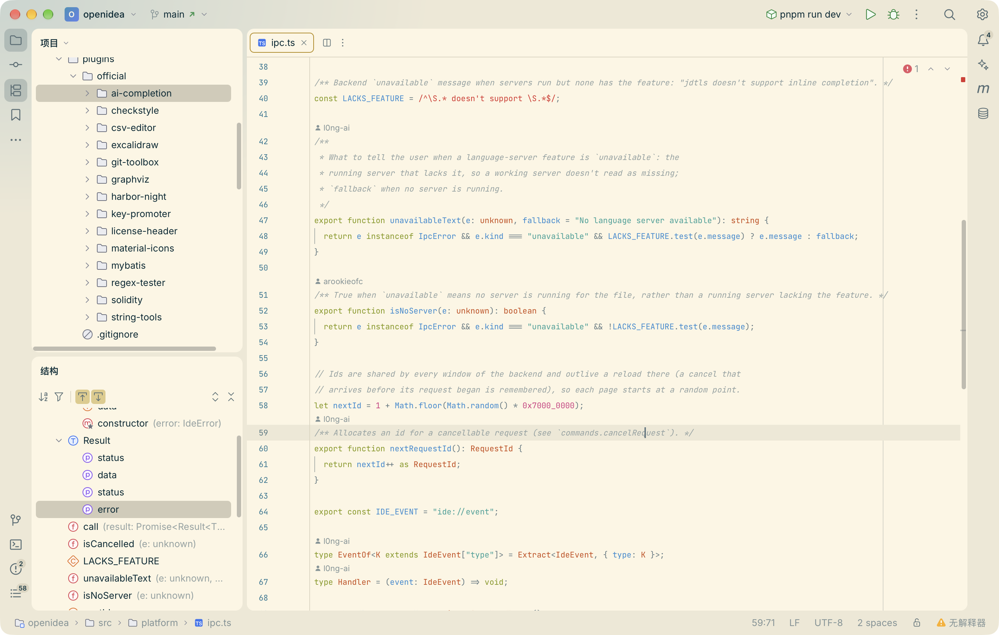
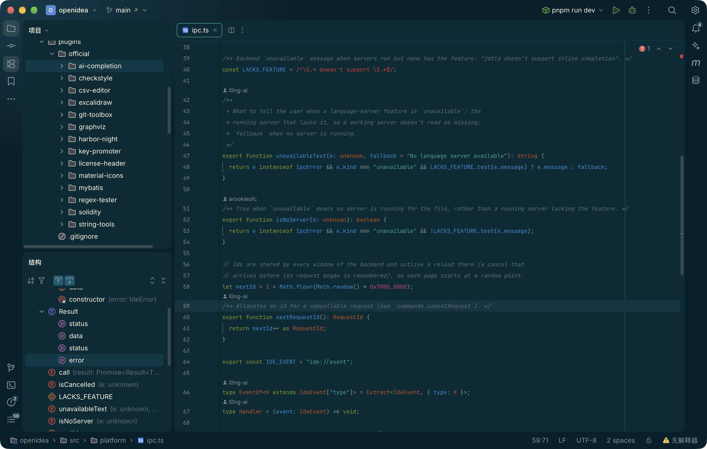

# Solarized (VS Code)

An OpenIDEA theme plugin with **Solarized Light** and **Solarized Dark** in the colours of
the themes bundled with Visual Studio Code. It is data only: no code, no WebAssembly,
no capabilities.

OpenIDEA already has built-in Solarized themes drawn from the original palette. This
plugin is for people who want the editor and workbench to look like VS Code's Solarized:
the same backgrounds, selections, syntax colours and terminal palette.

| Solarized Light (VS Code) | Solarized Dark (VS Code) |
| --- | --- |
|  |  |

Both screenshots are OpenIDEA's own source open in the editor, taken in a running build of
OpenIDEA `main` after installing this package with *Install Plugin from Disk…*.

```
.
├─ plugin.toml                              # manifest: id, name, version, the two themes
├─ LICENSE                                  # MIT: Solarized palette + VS Code themes
├─ screenshots/                             # the images above
└─ themes/
   ├─ vscode-solarized-light.theme.json     # UI colours
   ├─ vscode-solarized-light.scheme.json    # editor colours: syntax, editor, ANSI
   ├─ vscode-solarized-dark.theme.json
   └─ vscode-solarized-dark.scheme.json
```

## Where the colours come from

Sources, from [`microsoft/vscode`](https://github.com/microsoft/vscode) `main`:
`extensions/theme-solarized-light/themes/solarized-light-color-theme.json` and
`extensions/theme-solarized-dark/themes/solarized-dark-color-theme.json`.

Mapped by the "From VS Code" tables in OpenIDEA's `docs/plugins/themes.md`:

- **Used as written:** `editor.*`, `sideBar`, `titleBar`, `list.*`, `input`, `dropdown`,
  `tab.*`, `editorWidget`, `focusBorder`, `editorIndentGuide`, the `terminal.ansi*` palette
  and every `tokenColors` foreground (keyword, string, number, type, function, tag, …).
- **VS Code leaves them to its base theme** (`vs` / `vs-dark`), so those values are used:
  Git decoration and gutter colours, error and warning squiggles, search highlights,
  line numbers, scrollbar thumbs and the matching-bracket background.
- **No VS Code counterpart** (OpenIDEA-only surfaces such as stripes, toggles, feedback
  banners, diff tints, ANSI bright slots): derived from the Solarized palette or mixed from
  the theme's own surfaces. Status colours are Solarized's red, yellow, green and blue.
- Light bracket-pair colours are not defined by VS Code's Solarized Light; they use
  base01, yellow and magenta, the dark theme's convention.

Two things come straight from VS Code and are worth knowing: the editor selection is the
same colour as the current line highlight in Solarized Light, and Solarized's syntax colours
(comments especially) are deliberately low contrast.

## Install

1. Open **Settings › Plugins**, gear menu, **Install Plugin from Disk…**, and pick this folder.
2. Select *Solarized (VS Code)* in *Installed* and press **Apply** next to a theme.
3. **Use Default Theme** goes back to the built-in theme.

To iterate, put (or symlink) this folder in `<project>/.openidea/plugins/` of an open
project, then *Reload* in Settings › Plugins.

## Licence

MIT. See [`LICENSE`](LICENSE).
